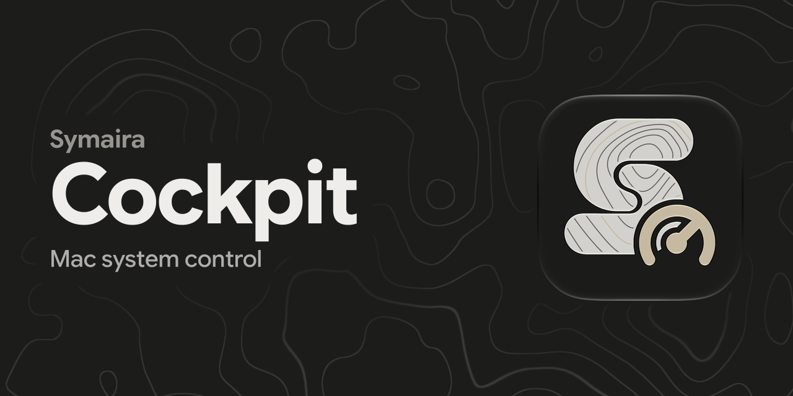
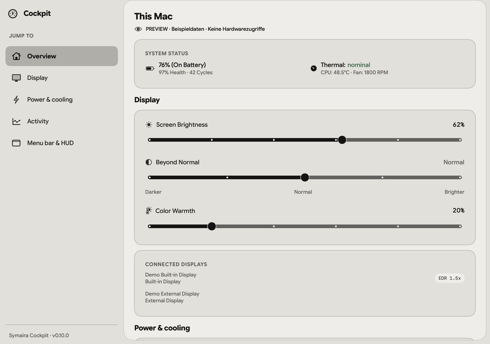

# Symaira Cockpit

> **Scope:** Symaira Cockpit provides macOS hardware/system tuning. The former operate and scope capabilities now live in Symaira Brain as optional modules; legacy `symcockpit operate` and `symcockpit scope` commands are removed. See [PB-2026-09-09](docs/product-boundaries.md).

**One command for your Mac: monitor and tune its hardware and system.**

`symcockpit` is a native macOS CLI and menu-bar app for thermals, power,
display, battery, fans and system metrics. Commands speak JSON and the
built-in MCP server exposes the same capabilities to AI agents.

[](https://github.com/danieljustus/symaira-cockpit/actions/workflows/ci.yml)
[](https://github.com/danieljustus/symaira-cockpit/releases)
[](https://github.com/danieljustus/symaira-cockpit/actions/workflows/ci.yml)
[](LICENSE)
[](#requirements)
[](https://swift.org)



**Status:** Active development. See the [release history](https://github.com/danieljustus/symaira-cockpit/releases) for published versions.

## Why Cockpit

The facts you constantly need while developing on a Mac are scattered across a
dozen places: Activity Monitor, `lsof`, Docker Desktop, System Settings,
`pmset`, and the harness registrations managed by symbrain. Symaira Cockpit
pulls the local machine facts into **one binary** with **one output format**:

- **Structured, not scrapeable.** Every command answers in JSON with stable
  field names. No parsing human-readable output, no `awk`.
- **Local, not cloud.** No telemetry, no account, no network access beyond the
  optional update check. What your Mac knows stays on your Mac.
- **Built for agents.** Cockpit runs as an MCP server over stdio on demand —
  the capabilities you have on the shell become tools for your AI assistant.
- **Native and fast.** Swift 6, straight against IOKit, Accessibility and
  ScreenCaptureKit. One universal binary, no runtime, no dependencies.

## Install

```bash
brew install danieljustus/tap/symcockpit
```

Or grab the universal binary (`arm64` + `x86_64`) from
[Releases](https://github.com/danieljustus/symaira-cockpit/releases) and drop it
into `/usr/local/bin`.

> The CLI binary is neither signed nor notarized. Installed via Homebrew,
> Gatekeeper's quarantine does not apply; after a manual download you need to
> clear it once (`xattr -d com.apple.quarantine ./symcockpit`).

### Fan control from the GUI needs a root-owned install

Changing fan speed from the menu bar app runs `symcockpit` as root behind
macOS's administrator prompt. The app therefore refuses to elevate a binary
that anything other than root can replace, and names the exact reason when it
does:

```
refusing to run /opt/homebrew/bin/symcockpit as an administrator: it is owned
by daniel, not root. … Install it in a root-owned location such as
/usr/local/bin.
```

Homebrew's prefix does not qualify on Apple Silicon: `/opt/homebrew` is owned
by the installing user and `/opt/homebrew/bin` is group-writable, so anyone who
can write there could have their own binary authenticated into root by your
password prompt. The same applies to `~/.symaira/bin`.

To use fan control from the GUI, install the binary somewhere only root can
write:

```bash
sudo install -o root -g wheel -m 755 "$(brew --prefix)/bin/symcockpit" /usr/local/bin/symcockpit
```

The app prefers this copy for elevation and keeps using the Homebrew one for
everything else. `brew upgrade` does not touch `/usr/local/bin`, so repeat the
command after every upgrade — otherwise fan control silently keeps driving the
older CLI while the rest of the app has moved on.

### Optional: the privileged fan helper (no password prompts)

The signed, notarized `Symaira Cockpit.app` can instead register a small
background helper with macOS (`SMAppService`, label
`com.symaira.symtune-helper`). Fan changes then need no administrator password
and no root-owned copy of the CLI, so a `brew upgrade` can no longer leave fan
control on an older binary.

It is **off by default**. To use it, open Preferences → *Privileged fan helper*
and switch it on:

1. Symaira Cockpit registers the helper. macOS asks you to approve it once
   under **System Settings → General → Login Items & Extensions**; the section
   shows *Waiting for your approval* with an *Open System Settings…* button
   until you do. While approval is pending, fan control keeps using the
   administrator prompt above, unchanged.
2. Once approved, fan changes go to the helper. It runs the same fan governor
   as the CLI, with the same safety clamps, and never turns off the Mac's own
   thermal protection.

What it will and will not do:

- The helper and the app each accept only the other: both ends of the XPC
  connection are pinned to the Developer ID team the release build was made
  for. That team identifier is baked into the build from the signing
  certificate and must equal the team in the binary's own signature; a build
  without it never registers or serves the helper. The helper additionally
  refuses peers that carry a hardened-runtime escape entitlement.
- Before registering, Cockpit refuses if the app bundle or the helper
  executable is writable by anyone but its owner (group/other-writable), is a
  symlink, or is owned by another user (every path component from the bundle
  root down to the helper, and again before each start). **Remaining trust
  assumption:** the helper runs as root from inside `Symaira Cockpit.app`. When
  you drag the app into `/Applications` it stays owned by you, so malware
  running as you can modify the bundle, and a modified helper would then run
  as root once the helper is registered. The pinned team only stops such a
  swapped helper from *pairing* with the app over XPC; it does not stop it from
  being executed. macOS App Management protection is the guard against other
  apps modifying a signed bundle, and it is not a boundary against malware that
  already runs as you with full disk access. To close the gap, make the bundle
  root-owned:
  `sudo chown -R root:wheel '/Applications/Symaira Cockpit.app'`
  (or keep the helper off).
- A `fan profile system` (or any `fan profile …`) from the CLI or an MCP
  client reaches a running helper too: the app compares the stored profile
  with the helper on every ping and stops or retargets it within about 2 s.
  The helper itself never reads files. It uses the built-in safety limits only
  (`SafetyPolicy` defaults); `SYMTUNE_FAN_*` and `config.toml` fan limits apply
  to the `osascript` path, not to the helper.
- The app pings the helper every ~2 s. If the pings stop for more than 7 s —
  the app was force-quit or crashed — the helper hands the fans back to the
  system curve, and it does the same on SIGTERM or when the connection drops.
  So the fans return to the system curve a few seconds after the app quits; with
  the helper on, the stored position is applied again the next time the app
  starts.
- It only changes fan profiles. Battery charge limits still use the
  administrator prompt.
- Unsigned, ad-hoc or locally built copies never register the helper and
  always use the `osascript` path, including its root-owned-binary checks.

**Removing it:** switch the toggle off in Preferences. Cockpit hands the fans
back, unregisters the helper and macOS removes the login-item entry. If the app
is no longer around, delete `Symaira Cockpit.app` and remove its entry under
System Settings → General → Login Items & Extensions, or run
`sudo launchctl bootout system/com.symaira.symtune-helper`.

The CLI, the MCP server, and reading sensors work from any install location.
Only elevation is restricted, and `sudo symcockpit fan set …` from a terminal
is unaffected, because there you name the binary yourself.

## Quick start

```console
$ symcockpit sensors
{ "thermal_pressure": "nominal", "fans": [ { "rpm": 1980 } ], "smc_supported": true }

$ symcockpit brightness set 0.5
```

## The GUI

Your Mac's display, power and cooling controls in one window.

<picture>
  <source media="(prefers-color-scheme: dark)" srcset="docs/assets/workspace-preview-dark.png">
  
</picture>

*Native SwiftUI component preview with example data, not live hardware readings.
Transparent chrome is flattened onto the shared sidebar color for documentation;
this is not a live-window capture. [Asset provenance](docs/assets/README.md).*

```bash
brew install --cask danieljustus/tap/symcockpit
```

installs the signed and notarized menu bar app from the releases page — or grab
the `Symaira-Cockpit-*.dmg` directly from
[Releases](https://github.com/danieljustus/symaira-cockpit/releases).

```bash
make build-app                       # builds build/app/Symaira Cockpit.app
make run-app                         # …and launches it
```

Symaira Cockpit lives in the menu bar, with a live readout and a compact
control panel one click away. Open the window from the panel or the status
item's context menu to go straight to the controls. A collapsible sidebar
jumps to Overview, Display, Power & cooling, Activity, or Menu bar & HUD
inside one mounted panel; it does not switch modules or discard draft values.
Narrow windows use an icon rail, while wide windows place the power and
cooling cards side by side. Both surfaces use the same model and cards, and
closing the window leaves the menu bar running.

The **Storage Volumes** card under **Activity** lists mounted internal disks,
external SSDs/HDDs, USB drives, memory cards and network/virtual volumes. Each
row shows its name, mount path, type, read-only state and total, used and
available capacity. Connecting, removing or renaming a mounted volume refreshes
the shared list; normal polling updates space usage. Hidden macOS helper
volumes are omitted. Unmounted or locked volumes are not listed.

Use **Choose…** in the card header to show or hide individual volumes. The
selection applies immediately to both panels and is saved automatically as a
GUI preference. New volumes are visible by default, and hidden disconnected
volumes keep their selection. Filesystem UUIDs preserve the choice across
renames/reconnects; filesystems without a UUID fall back to their mount path.
Even with every volume hidden, **Choose…** remains available. CLI/MCP metrics
still report all discovered volumes, independent of this display preference.

Storage sizes use decimal units, like Finder. Available capacity can include
purgeable APFS data, and APFS volumes can share a container, so the rows are
not summed into a misleading total. Missing capacity is labelled unavailable.
The existing **Disk** metric stays boot-volume-only. `symcockpit metrics` and
the MCP `get_system_metrics` tool include this same list in `volumes`.

Jump to **Menu bar & HUD** to customize the readout without
leaving the panel. Its **Menu bar** card is the quick way to change the status
item: one switch per metric for *Monitor* (sample it) and one for *Menu bar*
(show it), with a live preview of the result. Changes hit the menu bar
immediately and are written to `config.toml`, so they survive a relaunch.
**GPU** is a fifth, opt-in metric: it is off in a fresh or existing setup until
you switch it on there (or list `"gpu"` in `[metrics] enabled` / `visible` /
`order`). Where a Mac publishes no GPU utilization the row is simply absent,
never a 0 %.

Display and fan controls use native sliders with rounded rails, guide dots
and light circular knobs in the shared neutral Liquid Topography palette.
Champagne is reserved for state accents. Display values
remain continuous; the fan slider selects **Standard**, **Cool**, or **Max**,
not arbitrary RPM. Existing temperature curves and administrator permission
checks still apply. Missing readings are labelled as loading rather than
reported as healthy measurements.

For hardware-isolated design previews in Xcode, see the
[workspace design and preview guide](docs/ui-workspace.md).

The Display card's **Brightness keys** row picks who answers F1 and F2:
**Standard** leaves them to macOS, **SymCockpit** consumes them before macOS
sees them, sets the built-in display's brightness itself, and draws its own HUD
— the same sixteen steps, with Shift+Option for quarter steps. macOS is the
default; the takeover needs an Accessibility grant, and the row says so and
offers the way to it instead of silently doing nothing. Volume and media keys
are never touched, a focused password field hands the keys straight back, and
switching to Standard removes the interception immediately.

The same card carries **Show in**, which picks *where* the readout appears —
the menu bar or the notch, one at a time rather than both at once. On a MacBook
with a camera cutout, **Notch** draws the readout around the notch and hides
the status item while it runs. It opens in two steps rather than one: the
pointer reaching it widens the shoulders for a readout or two more, and a click
unfolds the full card — every readout you placed there, plus a way into the
panel or the window. A second click, or moving away, puts it back. Dragged, it
resists and stretches for a moment before it comes off the bezel, and springs
back if you let go near nothing.

**HUD content** below it decides what is on the HUD: per readout, whether it
appears, which side it sits on, and how far the HUD has to be open before it
does. It applies as you change it. The menu bar is the default, the choice explains itself instead
of appearing when the display has no cutout, and a display without one always
gets the status item back, so the app is never left with nothing on screen. The
HUD stays put across spaces and over full-screen apps, and it never takes
focus: clicking it does not pull the app in front of what you were working in.

`⌘0` opens the window and `⌘,` opens preferences. The toolbar's gear opens
the same preferences window.

Nothing in the window has its own logic: every number comes from the same core
services the CLI calls, so the window and the shell cannot disagree.

> macOS keys permissions and Keychain access to the binary, so the app asks for
> its own grants the first time you use those features — separately from the
> CLI, even on the same Mac.

### AI usage

The AI usage card shows subscription and token usage per provider (Claude,
Codex, GitHub Copilot, Cursor, Kimi Code, Moonshot, Nous Portal, OpenCode Go,
OpenRouter, Antigravity, Z.ai, Devin, Grok and Ollama Cloud). Provider
discovery, auth status and credential resolution belong to `symbrain`; Cockpit
passes it opaque `symvault://` references only, and API keys entered in
Preferences are stored in SymVault, never in `config.toml` or Cockpit's
Keychain items.

- **Providers are opt-in.** Only providers you enable in Preferences →
  *AI Usage* are queried by the app; you can star, reorder and hide them.
- **Local cost history is opt-in per source.** Reading local Claude, Codex,
  Grok or OpenCode session usage is off until you switch it on, and recorded
  and estimated costs are shown separately.
- **Local usage API (off by default).** The card's *Local usage API* switch, or
  `symcockpit ai-usage serve [--port 6737]`, serves the cached snapshots as
  JSON on `127.0.0.1` only: `GET /v1/limits` and `GET /v1/usage`, optionally
  followed by `/<provider-id>`. It never contacts a provider, serves only the
  providers enabled in the app, refuses browser-origin requests and any host
  other than the literal `127.0.0.1:<port>`. Other local processes can read
  it while it runs.

From the shell, `symcockpit ai-usage [provider] [--json] [--force]` prints the
same report. Without a provider argument it, and the MCP `get_ai_usage` tool,
query every catalog provider regardless of the app's selection.

## Commands

Direct `symcockpit` commands expose thermals, power, battery, display, fan,
brightness, profiles, diagnostics and the MCP server. The old
`symcockpit tune <command>` spelling prints a warning to stderr and is still
supported in v0.10; its removal waits for the remaining migration checks
(#259). Migrate clients to the direct spelling now.

```text
symcockpit doctor
symcockpit sensors
symcockpit brightness set 0.5
symcockpit serve
```

## MCP / Agent integration

Cockpit speaks the Model Context Protocol over stdio. Add the server to an
agent configuration:

```json
{
  "mcpServers": {
    "cockpit-tune": { "command": "symcockpit", "args": ["serve"] }
  }
}
```

In `serve`, `stdout` carries JSON-RPC and nothing else; logs and
diagnostics go to `stderr`.

## Permissions and safety

Cockpit asks only for what it needs:

| Capability | Requires |
| :--- | :--- |
| Sensors, battery, metrics, brightness | nothing |
| Fans, charge limit | `sudo` (SMC write) |

Every write action is recorded in local history and restored safely on normal
exit.

## Output contract

- **JSON everywhere.** Snake-case fields, stable keys, `--json` wherever a
  human-readable variant exists. Streams (`watch`) emit NDJSON.
- **Exit codes:** `0` success · `1` error · `2` usage/config · `3` missing
  permission · `4` unsupported on this system.
- **XDG paths:** config under `~/.config/`, cache under `~/.cache/`, data under
  `~/.local/share/`.

```bash
symcockpit version --json
```

## Requirements

- macOS 26 or newer, Apple Silicon or Intel
- Fan and charge-limit control: access to the Apple SMC — not every model and
  not every macOS build permits it, and `symcockpit sensors` will tell you

Unsupported capabilities report exit code `4` cleanly instead of guessing.

## Build from source

```bash
git clone https://github.com/danieljustus/symaira-cockpit.git
cd symaira-cockpit
make build      # Debug build of the tuning package and history
make test       # Test suite
make build-app  # The GUI bundle (build/app/Symaira Cockpit.app)
swift build -c release --arch arm64 --arch x86_64
```

The repository is an SPM workspace: `Sources/symcockpit/` is the dispatcher,
`Sources/SymCockpitApp/` the GUI,
and [`tuning/`](tuning/) are
a standalone package with its own test suite. Contributor details live in
[AGENTS.md](AGENTS.md).

> The app targets and the tests need the Xcode toolchain:
> `DEVELOPER_DIR=/Applications/Xcode.app/Contents/Developer swift build`

## Contributing

Issues and pull requests are welcome. For anything larger than a fix, please
open an issue first so we can agree on the direction. Every contribution should
pass `make build` and `make test`.

## License

[Apache License 2.0](LICENSE) — © Daniel Justus
