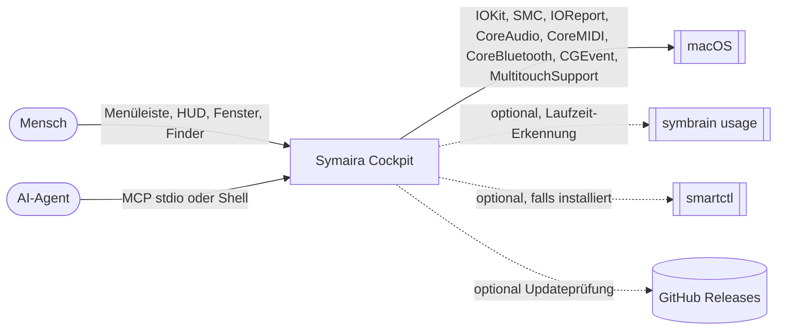
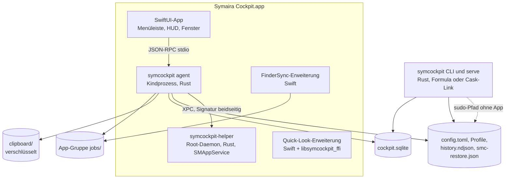
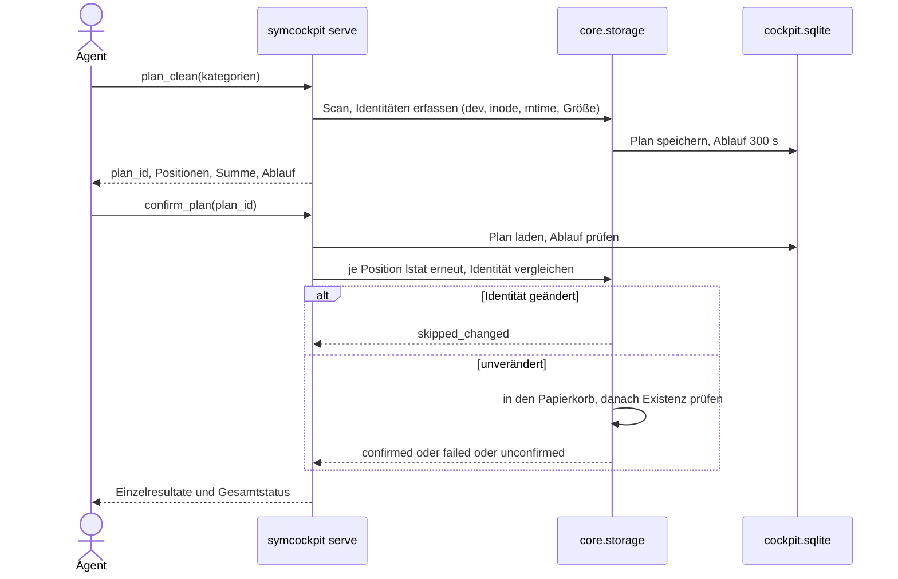
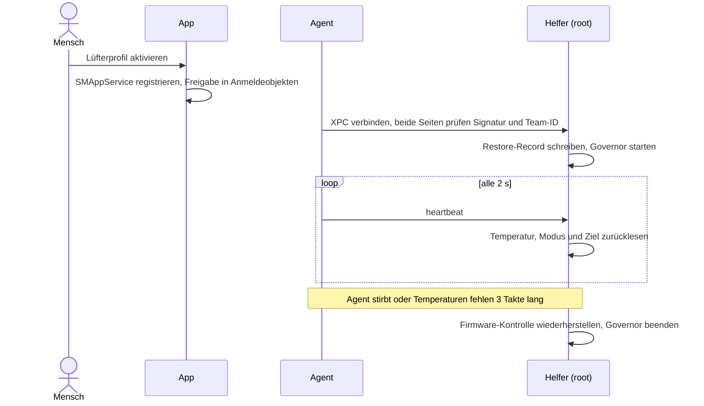

# Architektur: Symaira Cockpit (Rust-Neuaufbau) v0.1

> Status: freigegeben (2026-11-20, Daniel; G4 alle drei Blöcke, G5) · Basis: [02-produktbrief.md](02-produktbrief.md), [03-loesungsoptionen.md](03-loesungsoptionen.md) (Option A, D14)

## Ergebnis zuerst

Ein Rust-Workspace im Repo `symaira-cockpit` erzeugt drei Artefakte: das Binary `symcockpit` (CLI, MCP-Server `serve`, App-Agent `agent`), den privilegierten Daemon `symcockpit-helper` und eine kleine C-ABI-Bibliothek für die App-Erweiterungen. Die SwiftUI-App, die Quick-Look- und die FinderSync-Erweiterung bleiben Swift und enthalten keine Fachlogik. Bestehende Dateien (`config.toml`, Profile, `history.ndjson`, `smc-restore.json`) bleiben formatgleich; neue Verläufe liegen in SQLite über CoreKit, die Zwischenablage getrennt und verschlüsselt. Größte Risiken: Rechte des Agent-Kindprozesses (Spike S1) und Regressionen beim SMC-Port (Spike S5).

## 1. Qualitätsziele

| ID | Qualität | Szenario | Priorität |
|---|---|---|---|
| Q01 | Korrektheit | WENN ein Setzen zurückkehrt, der gelesene Zustand aber abweicht DANN SOLL das Ergebnis `unconfirmed` lauten | 1 |
| Q02, Q03 | Sicherheit | WENN eine riskante Aktion ausgeführt wird DANN SOLL ein gültiger Plan mit unveränderten Objektidentitäten vorliegen und der Helfer Aufrufer und Parameter selbst prüfen | 1 |
| Q09 | Kompatibilität | WENN ein Nutzer von v0.12 wechselt DANN SOLLEN Befehle, MCP-Namen, Felder, Pfade, Keychain und Helfer-Identität unverändert funktionieren | 1 |
| Q04 | Effizienz | WENN keine Ansicht und kein Abonnement einen Messwert braucht DANN SOLL er nicht gemessen werden; App im Leerlauf ≤ 1 % CPU (Z4) | 2 |
| Q07 | Testbarkeit | WENN Tests laufen DANN SOLL keine Hardware beschrieben werden; jede Plattformquelle hat einen Fake | 2 |

Vollständige Liste Q01 bis Q10: [02-produktbrief §6](02-produktbrief.md).

## 2. Randbedingungen

| Art | Randbedingung | Quelle |
|---|---|---|
| Plattform | macOS arm64, Mindestversion macOS 26; Release nur noch arm64 statt universal | Plattformbeschluss 2026-10-29, README |
| Sprache | Rust (Edition 2024, Toolchain wie CoreKit 1.98) für Kern, CLI, MCP, Helfer; Swift 6 nur für App und Erweiterungen | D06 |
| Vertrag | Revision 9 erweitert Cockpit (D02); Scope, Operate, PDF bleiben bei Brain bzw. Desktop | PB-2026-09-09 |
| Identität | `com.symaira.symtune`, `com.symaira.symtune-helper`, `~/.config/symtune/`, `SYMTUNE_*`, Exit-Codes 0 bis 4 bleiben | D11 |
| Organisation | Ein Entwickler mit Agenten; lokale Integration, GitHub als Speicherstand | Daniel |
| Kosten | Keine kostenpflichtigen Dienste | Daniel |
| Lizenz | Apache-2.0; GPL nur als Muster | `candidates.json` |

## 3. Kontext (C4 Ebene 1)

| Nachbar | Schnittstelle | Daten |
|---|---|---|
| Mensch | SwiftUI-App, Finder-Kontextmenü, Quick Look, CLI im Terminal | Anzeigen, Bestätigungen |
| AI-Agent | `symcockpit serve` (MCP) oder CLI mit `--json` | Lesewerte, Pläne, Bestätigungen; nie Zwischenablage, nie Eingabe |
| macOS | Plattform-Crate `symcockpit-macos` | Messwerte, Gerätezustände, Schreibvorgänge |
| Brain | Subprozess `symbrain usage` mit `symvault://`-Referenzen statt Secrets | AI-Kontingente, später Session-Status |

## 4. Lösungsstrategie

- **Ein Befehlsregister** (`symcockpit-contract`) beschreibt jeden Befehl mit Bereich, Risikoklasse, Exposition und JSON-Schema. CLI, MCP und Agent-Protokoll entstehen daraus (D08).
- **Ports und Adapter:** Fachlogik in `symcockpit-core` spricht nur Traits; `symcockpit-macos` implementiert sie und ist der einzige Ort mit `unsafe` (D07).
- **Ergebnis erst nach Bestätigung:** Jede Aktion endet in `confirmed`, `unconfirmed`, `failed`, `unsupported` oder `skipped_changed`.
- **Messung nach Bedarf:** Abonnements steuern die Sampler; ohne Abonnent wird nichts gemessen.
- **Strangler-Migration:** Rust wächst neben Swift; Swift v0.12 liefert Orakel und Testvektoren; der Swift-Kern fällt erst, wenn alle Fixtures grün sind (D12).

## 5. Bausteine

### 5.1 Container (C4 Ebene 2)

### 5.2 Rust-Crates

| Crate | Verantwortung | `unsafe` | Besitzt Daten |
|---|---|---|---|
| `symcockpit-contract` | Befehlsregister, Schemata, `Outcome`, Plan-Typen, Protokollversion | verboten | nein |
| `symcockpit-core` | Fachmodule `monitor`, `tune`, `storage`, `apps`, `audio`, `bluetooth`, `input`, `finder`, `clipboard`; Regeln (SMART-Note, Bereinigungskatalog, Besitzplan, Lüfter-Governor) | verboten | nein |
| `symcockpit-macos` | Adapter: IOKit, SMC, IOReport, IOAccelerator, Mach, libproc, NVMe-SMART, DiskArbitration, CoreAudio inkl. Process Taps, CoreMIDI, CoreBluetooth, CGEvent-Tap, NSPasteboard, MultitouchSupport (dlopen), Security, XPC | erlaubt, nur hier | nein |
| `symcockpit-testkit` | Fakes für jeden Port, aufgezeichnete Plattform-Snapshots | verboten | Testdaten |
| `symcockpit-store` | Formatgleiche Dateien aus v0.12; SQLite über `symaira-core-sqlite`; Zwischenablagespeicher | verboten | ja |
| `symcockpit-helper-proto` | Typisierte XPC-Nachrichten des Helfers | verboten | nein |
| `symcockpit` (bin) | Modi CLI, `serve`, `agent` | verboten | nein |
| `symcockpit-helper` (bin) | Lüfter, Governor, Ladegrenze (nur falls S8 einen root-Weg braucht), SMC-Restore, Entfernen root-eigener Reste aus geprüftem Plan | nur über `symcockpit-macos` | `smc-restore.json` (root) |
| `symcockpit-ffi` (staticlib) | C-ABI für Erweiterungen: Ordner- und Archivliste mit Limits, Ergebnis als JSON | nur an der ABI-Grenze | nein |

### 5.3 Risikoklassen und Exposition

| Klasse | Beispiele | CLI | MCP | Agent-Protokoll (App) |
|---|---|---|---|---|
| `read` | Status, Sensoren, Prozesse, SMART, Platz, Audiogeräte, BLE-Scan | ja | ja | ja |
| `reversible` | Helligkeit, EDR, Wärme, Dimmen, Wachhalten, Lautstärke pro App | ja | direkt | ja |
| `risky` | Bereinigen, Duplikate entfernen, Deinstallieren, Lüfter, Ladegrenze, Prozess beenden, Audio-Gerätekonfiguration, BLE-Schreiben | TTY: Rückfrage; sonst Plan und `--confirm <id>`; kein `--yes` | nur `plan_*` und `confirm_plan` | Bestätigung in der App |
| `human_only` | Zwischenablageverlauf lesen, Finder-⌘X, Haptik, Finder-Aktionen | nur `clipboard status`, `pause`, `clear` | nie | ja |

Ein Registertest stellt sicher, dass `tools/list` keinen `human_only`-Befehl enthält und `serve` die Zwischenablagedatei nie öffnet (D10, D13).

## 6. Laufzeitsicht

### 6.1 Riskante Aktion über MCP (mit Abbruchfall)

### 6.2 Lüftersteuerung über den Helfer (mit Absturzfall)

### 6.3 Weitere Szenarien

| Szenario | Ablauf | Fehlerfall |
|---|---|---|
| App-Start | App startet `symcockpit agent --stdio`, Handshake mit Protokollversion, Abonnements je sichtbarer Ansicht (1 s sichtbar, 10 s verborgen) | Agent fehlt oder Version passt nicht: App zeigt Diagnose, keine Fantasiewerte |
| Samplerate setzen | Vorbedingung prüfen, setzen, OSStatus auswerten, Property zurücklesen | Readback weicht ab: `unconfirmed`, vorheriger Zustand bleibt sichtbar |
| Finder-Aktion | FinderSync schreibt Auftrag `jobs/<uuid>.json` atomar (Ablauf 60 s), App reicht ihn an den Agent, Ergebnis `jobs/<uuid>.result.json` | Doppelter oder abgelaufener Auftrag wird abgewiesen; Dateinamen bleiben Daten |
| Quick Look Archiv | Erweiterung ruft `symcockpit_ffi_list` mit Limits für Einträge, Gesamtgröße, Tiefe und Zeit | Grenze überschritten: Teilansicht mit Hinweis, nichts wird entpackt |

## 7. Daten

| Entität | Ort | Format und Migration | Löschung, Export |
|---|---|---|---|
| Konfiguration | `~/.config/symtune/config.toml` | TOML, bestehende Schlüssel bleiben, neue Abschnitte je Bereich | Nutzer |
| Profile, Regeln, Lüfterprofil | `profile-*.json`, `rules.json`, `fan-profile.json` | formatgleich zu v0.12 | Nutzer |
| SMC-Restore-Record | `smc-restore.json` | formatgleich; vor der ersten Änderung geschrieben | nach Wiederherstellung |
| Metrikverlauf | `history.ndjson` | formatgleich; Umzug nach SQLite nur per eigener Migration | begrenzt wie heute |
| SMART-Messungen mit Algorithmusversion, Platzverlauf, Speedtest-Ergebnisse, Pläne | `~/.local/share/symtune/cockpit.sqlite` | WAL, `user_version`-Migrationen, Leser ohne Reparaturrechte | Export JSON und CSV; Pläne verfallen |
| Zwischenablage | `~/.local/share/symtune/clipboard/` | eigene SQLite plus Anhänge, AES-GCM mit Schlüssel im Keychain (nur dieses Gerät), von Time Machine ausgeschlossen, Aufbewahrung begrenzt | Löschen entfernt Metadaten und Anhänge; Anhänge erst nach bestätigtem Metadaten-Commit aufräumen |
| Finder-Aufträge | App-Gruppen-Container `jobs/` | JSON mit Version und Ablauf | nach Ergebnis oder Ablauf |
| Speedtest-Dateien | `<Ziel>/.symcockpit-speedtest-<sitzung>/` | `O_EXCL`, Sitzungskennung | nur eigene Sitzungsdateien |
| Credentials | Keychain `com.symaira.symtune` | unverändert | Nutzer |

## 8. Schnittstellen und Verträge

| Schnittstelle | Art | Version | Fehlerverhalten | Konsument |
|---|---|---|---|---|
| `symcockpit <befehl>` | CLI, `--json` | bestehende Befehle unverändert; neue unter Bereichen (`storage`, `apps`, `audio`, `midi`, `bt`, `ble`, `input`, `clipboard`); Kollisionsprüfung nach PB §4 | Exit 0 bis 4, Fehler-JSON auf stdout bei `--json`, Logs auf stderr | Mensch, Skripte, Agenten |
| `symcockpit serve` | MCP stdio über `symaira-core-mcp` | 26 bestehende Toolnamen bleiben (12 davon lesend; Korrektur nach Orakel-Aufnahme); neue `get_*`, `list_*`, `plan_*`, `confirm_plan`; Annotationen `readOnlyHint`, `destructiveHint` | stdout nur JSON-RPC | Agenten |
| `symcockpit agent --stdio` | JSON-RPC 2.0 als NDJSON, `hello`, `call`, `subscribe`, Ereignisse | Protokollversion im Handshake | startet nur mit signierter Cockpit-App als Elternprozess; sonst Exit 3 | SwiftUI-App |
| Helfer | XPC-Machdienst `com.symaira.symtune-helper` | Nachrichtenversion | Peer-Signaturprüfung beidseitig; unbekannte Aktion abgewiesen | Agent, App |
| `libsymcockpit_ffi` | C-ABI, JSON-Ergebnis, eigene Freigabefunktion | ABI-Version | Fehler als JSON, nie Panik über die Grenze | Erweiterungen |
| Exporte | JSON, CSV nach RFC 4180 | Schemaversion im Kopf | Schreiben atomar | Mensch |
| Brain | Subprozess `symbrain usage` | bestehender Vertrag | Timeout, sichtbare Degradation | Monitor |

## 9. Verteilung und Betrieb

| Komponente | Läuft | Build und Signierung | Verteilung | Updates |
|---|---|---|---|---|
| `symcockpit` | Nutzerprozess | `cargo build --release`, aarch64; Developer ID und Notarisierung (heute ist die CLI unsigniert) | Formula (CLI ohne App) oder Cask-Link auf das gebündelte Binary, gegenseitig ausschließend (D15) | Homebrew; CoreKit-Updateprüfung respektiert den Update-Besitzer |
| App | Nutzersession | SwiftPM wie heute plus eingebettete Rust-Binaries und Erweiterungen; Bau der `.appex` klärt Spike S6 | Cask, DMG | Cask |
| `symcockpit-helper` | root, launchd | im App-Bundle, signiert mit derselben Team-ID | registriert erst beim Aktivieren von Lüfter, Ladegrenze oder root-Entfernung | mit der App; `osascript`-Pfad bleibt Rückfall für lokale Builds |
| Erweiterungen | Quick Look, Finder | im App-Bundle, Sandbox mit minimalen Rechten | mit der App | mit der App |

Laufende Kosten: keine; Apple Developer Account besteht bereits.

## 10. Querschnittliche Konzepte

| Konzept | Festlegung | Herkunft |
|---|---|---|
| Vertrauensgrenzen | (1) MCP-Client zu `serve`: Register, Zwei-Schritt-Pläne, kein `human_only`. (2) App zu Agent: stdio, Elternprüfung per Code-Signatur. (3) Agent zu Helfer: XPC, Signatur beidseitig, typisierte Aktionen, Revalidierung, Heartbeat. (4) FinderSync zu App: Auftragsdateien mit Schema, Ablauf, ID. (5) Quick Look zu fremden Archiven: Limits, kein Entpacken. (6) Externe Programme (`smartctl`, `pkgutil`, `symbrain`): feste Pfade, Argumentliste, Timeout, Exit-Code-Liste | RE/Aktivitätsanzeige §4, RE/Uninstaller §3, RE/DriveDx, RE/MouseBoost Pro §1 |
| Restrisiko | Prozesse desselben Benutzers können Dateien und Speicher lesen; die Schutzschichten sind Abwehr in der Tiefe, kein OS-Sandbox-Ersatz | PB §3 |
| Datenschutz | Keine Telemetrie; neue Speicher ohne Prozessnamen per Standard; BLE-Logs nur bei ausdrücklichem Export; Zwischenablage nur für den Menschen | Q08, D13 |
| Messwerte | Wert, Einheit, Zeitstempel (monoton), Quelle, Qualität und Zugriffsstatus getrennt; Lücke statt Scheinspitze; Einheiten MiB und MB ausdrücklich | RE/Aktivitätsanzeige §2, RE/Codenotch §2, RE/Disk Speed Test §2 |
| Zustände | Aufträge `requested`, `running`, `succeeded`, `failed`, `cancelled`; Ergebnis als Nachbedingung | RE/Burrow §3, RE/LightBlue §1 |
| Geräteidentität | Stabile UID für Wiedererkennung, flüchtige Objekt-ID für Zugriffe; Generationen gegen späte Antworten | RE/Audio-MIDI-Setup, RE/Codenotch §1 |
| Fähigkeiten | Je Funktion `available` oder `unsupported` mit Grund und Stufe `documented`, `undocumented`, `private`; Abschaltbar per Konfiguration | D09, RE/Feel My Mac |
| Nebenläufigkeit | Agent: Hauptthread mit CFRunLoop für Plattform-Callbacks, Threads für Sampler, ein Schreib-Thread je SQLite; kein Async-Runtime-Zwang (CoreKit-MCP ist synchron) | `symaira-core-mcp` |
| Logs | stderr; keine Secrets; Redaktion wie `SecretRedactor` aus `history/` | AGENTS.md |
| GUI | Symaira Interface Guidelines, `gui-review.py`, Texte über `L("...")` mit deutschem Eintrag; App rendert nur Snapshots | CoreKit `swift/GUIDELINES.md`, #418 |
| Tests | Einheiten mit Fakes; Schema-Snapshots je Befehl und `tools/list`; Testvektoren aus den 25.662 Swift-Testzeilen übernommen; Struktur- und Einheitenvergleich Swift gegen Rust auf derselben Maschine; Sicherheitstests (Planablauf, Symlinktausch, Elternprüfung, falsche Helfer-Signatur, Zwischenablage aus `serve` unerreichbar); Hardwareabnahme getrennt und opt-in | Q07, `tuning/docs/hardware-matrix.md` |

## 11. Wiederverwendung

| Baustein | Quelle | Lizenz | Entscheidung |
|---|---|---|---|
| MCP, Config, Log, Exit, Version, Update, SQLite | CoreKit | Apache-2.0 | Abhängigkeit |
| Framework-Zugriff | objc2-Crates | Zlib OR Apache-2.0 OR MIT | Abhängigkeit |
| Leistung und Frequenz | macmon | MIT | Abhängigkeit nach Spike S2, sonst eigener IOReport-Adapter |
| Prozesse, Hoststatistik | libproc, mach2 | MIT bzw. BSD/MIT/Apache | Abhängigkeit |
| Platzanalyse, Duplikate | dua-cli, czkawka_core | MIT | Abhängigkeit |
| Papierkorb | trash | MIT | Abhängigkeit |
| MIDI | coremidi | MIT | Abhängigkeit |
| BLE | btleplug oder objc2-core-bluetooth | MIT/Apache/BSD bzw. Zlib/Apache/MIT | Wahl in Stufe Bluetooth (Frage 3) |
| Archive | zip, sevenz-rust2, tar | MIT, Apache-2.0 | Abhängigkeit |
| SMC, Sensoren, Gamma, Governor | Swift-Cockpit v0.12 | Apache-2.0 | Port mit Testvektoren |
| Monitor-, Bereinigungs-, Notch-Abläufe | Stats, Burrow, Codenotch | MIT | Muster |
| Mixer, Lüfter-Helfer | Vorssaint | GPL-3.0 | nur Muster |

## 12. Risiken

| ID | Risiko | Wahrscheinlichkeit | Auswirkung | Gegenmaßnahme |
|---|---|---|---|---|
| K1 | Agent-Kindprozess erhält Bluetooth-, Bedienungshilfen- oder Audioaufnahme-Recht der App nicht | mittel | hoch | Spike S1; Rückfall Rust-Bibliothek nur für diese Funktionen (D14) |
| K2 | Regressionen beim SMC- und Sensor-Port | mittel | hoch | Testvektoren, Strukturvergleich, Spike S5, Swift bleibt bis Parität |
| K3 | macOS-Update bricht SMC, IOReport oder MultitouchSupport | mittel | mittel | Fähigkeitserkennung, `unsupported`, Abschalter, CI auf aktuellem macOS |
| K4 | Datenverlust durch Bereinigung oder Deinstallation | niedrig | hoch | Plan, Revalidierung, Papierkorb, Einzelresultate, Renntests |
| K5 | Erweiterungen ohne Xcode-Projekt nicht sauber baubar oder signierbar | mittel | mittel | Spike S6: Skript-Bündelung gegen XcodeGen |
| K6 | Umfang überfordert die Stufenplanung | hoch | mittel | Jede Stufe allein nützlich; Swift-Cockpit läuft bis zur Ablösung weiter |
| K7 | Mixer lässt Apps stumm oder braucht unerwartete Rechte | mittel | mittel | Spike S4, Rückfallmuster aus RE/Vorssaint §2 |
| K8 | Zwischenablage gelangt über Umwege an Agenten | mittel | hoch | Kein CLI- oder MCP-Lesepfad, Elternprüfung, Verschlüsselung, Test; Restrisiko dokumentiert |
| K9 | App-CPU-Last wie #418 kehrt zurück | mittel | mittel | Z4 als Abnahme jeder Stufe; App rendert nur geänderte Snapshots |
| K10 | CLI und Agent schreiben gleichzeitig Gamma oder Lüfter | niedrig | mittel | Semantik wie v0.12 mit Restore-Records; Weiterleitung an den Agent nur bei belegtem Bedarf |
| K11 | Ladegrenze: Firmware ab macOS 27 hat keine SMC-Ladeschlüssel mehr, Ersatz nur über die Ladegrenze von macOS (S5, #420) | eingetreten | mittel | Spike S8; Mechanismus nach Vorhandensein wählen, nicht nach macOS-Version; sonst `unsupported` |

## 13. Entscheidungen

| ADR | Titel | Status |
|---|---|---|
| [0001](../../adr/0001-rust-binary-als-cli-mcp-und-app-agent.md) | Ein Rust-Binary als CLI, MCP und App-Agent | angenommen (2026-11-20) |
| [0002](../../adr/0002-produktumfang-revision-9.md) | Produktumfang und Vertragsrevision 9 | angenommen (2026-11-20) |
| [0003](../../adr/0003-strangler-migration-mit-orakel.md) | Strangler-Migration mit v0.12-Orakel | angenommen (2026-11-20) |
| [0004](../../adr/0004-unsafe-grenze-und-private-apis.md) | `unsafe`-Grenze und private Schnittstellen | angenommen (2026-11-20) |

## 14. Nachverfolgbarkeit

| Anforderung | Baustein | ADR | Abnahme oder Spike |
|---|---|---|---|
| R01, R02, R03, R05, R06 | contract, `symcockpit` | 0001, 0003 | Schema-Snapshots, `tools/list`-Snapshot, Orakel |
| R04 | contract, store (Pläne) | 0001 | Planablauf- und Identitätstests |
| R10 bis R16, R18 | core.monitor, macos (Mach, libproc, IOAccelerator, IOReport, SMC) | 0004 | Testvektoren, S2, Z4-Messung |
| R17 | core.monitor, Brain-Subprozess | 0001 | Fixture mit synthetischen Brain-Ausgaben |
| R20 bis R22 | core.tune, helper, macos.smc | 0003, 0004 | S5, Hardware-Matrix opt-in, Absturztest des Helfers |
| R30, R31, R39 | core.storage, macos.nvme | 0004 | S3, Regeltabelle mit Versionstests |
| R32 | core.storage | | Einheiten- und Besitztests |
| R33 bis R36, R38 | core.storage, store | | Rennen-, Hardlink- und Prognosetests |
| R37 | core.apps, helper (root-Reste) | | Zwei-ähnliche-Apps-Test, Dokumentausschluss |
| R40 bis R45 | core.audio, macos.coreaudio, coremidi | 0004 | S4, Readback-Fehlertests mit Fake-HAL |
| R50 bis R54 | core.bluetooth, macos.bluetooth | | S1, ACK/Readback-Fakes, CSV-Roundtrip |
| R60, R61 | core.input, macos (CGEvent, MultitouchSupport) | 0004 | S1, Frontmost-Gate-Test, Fehlerstufentest |
| R70, R71 | Quick-Look-Erweiterung, `symcockpit-ffi` | | S6, Zip-Bomb-Fixture |
| R72 | FinderSync, core.finder, App-Gruppe | | Paralleltest zweier Aufträge |
| R73 | core.clipboard, store (verschlüsselt) | | Ausschluss-, Pause- und Löschtests; `serve`-Unerreichbarkeit |
| R07 | später App Intents | | nicht im MVP |
| Q01 bis Q10 | siehe §10 | 0001 bis 0004 | siehe §10 Tests |

## 15. Offene Fragen

1. App-Erweiterungen bauen: XcodeGen-Projekt zulassen (heute bewusst ohne Xcode-Projekt) oder Skript-Bündelung? Entscheidet Spike S6.
2. `history.ndjson` langfristig nach SQLite migrieren oder beim Format bleiben?
3. BLE über btleplug (bringt eine Async-Runtime mit) oder direkt über objc2-core-bluetooth (für virtuelle Peripherie später ohnehin nötig)?
